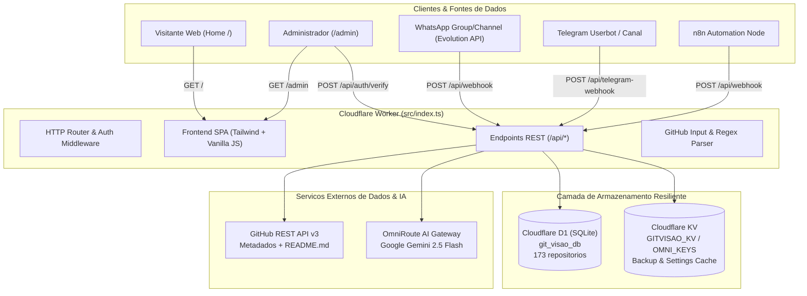

# 📑 DOCUMENTO OFICIAL DE PASSAGEM DE BASTÃO — GITVISÃO

> **Projeto:** GitVisão • Catálogo Inteligente "Pega a Visão" na Borda da Cloudflare  
> **Status Operacional:** 🟢 100% Operacional em Produção | 12/12 Testes Automatizados Aprovados  
> **Data de Emissão:** 26 de Outubro de 2026  
> **Responsável / Autor:** Passagem de Bastão Documentation Lead (Antigravity)  
> **Proprietário / Titular:** Samuel  

---

## 🧭 SUMÁRIO GERAL

1. [Visão Executiva & Contexto do Projeto](#1-visão-executiva--contexto-do-projeto)
2. [Ambientes, Credenciais e URLs de Produção](#2-ambientes-credenciais-e-urls-de-produção)
3. [Arquitetura de Software e Infraestrutura Cloudflare](#3-arquitetura-de-software-e-infraestrutura-cloudflare)
4. [Banco de Dados D1 e Esquema Relacional (30 Colunas)](#4-banco-de-dados-d1-e-esquema-relacional-30-colunas)
5. [Mecanismos de Persistência Híbrida & Alta Disponibilidade (D1 + KV)](#5-mecanismos-de-persistência-híbrida--alta-disponibilidade-d1--kv)
6. [Integração de IA (OmniRoute + Gemini) & Modo Fallback Determinístico](#6-integração-de-ia-omniroute--gemini--modo-fallback-determinístico)
7. [Ficha Técnica: Licenças, Custos e Dificuldade de Instalação](#7-ficha-técnica-licenças-custos-e-dificuldade-de-instalação)
8. [Templates Virais & As 10 Macro-Categorias](#8-templates-virais--as-10-macro-categorias)
9. [Segmentação de Interface: Home Pública (/) vs Área Administrativa (/admin)](#9-segmentação-de-interface-home-pública--vs-área-administrativa-admin)
10. [Especificação Completa das APIs REST](#10-especificação-completa-das-apis-rest)
11. [Porta de Entrada para Bots (WhatsApp Evolution API, Telegram e n8n)](#11-porta-de-entrada-para-bots-whatsapp-evolution-api-telegram-e-n8n)
12. [Scripts e Ferramentas Operacionais](#12-scripts-e-ferramentas-operacionais)
13. [Suíte de Testes Automatizados (12/12 Passando)](#13-suíte-de-testes-automatizados-1212-passando)
14. [Guia de Operação & Manutenção Contínua](#14-guia-de-operação--manutenção-contínua)
15. [Troubleshooting & Resolução de Problemas Conhecidos](#15-troubleshooting--resolução-de-problemas-conhecidos)
16. [Orientações Finais para o Próximo Mantenedor / Agente](#16-orientações-finais-para-o-próximo-mantenedor--agente)

---

## 1. VISÃO EXECUTIVA & CONTEXTO DO PROJETO

O **GitVisão** é uma plataforma serverless inovadora desenvolvida para curadoria, catalogação e sumarização de repositórios open source do GitHub no consagrado formato **"Pega a Visão"**. O formato é amplamente utilizado em comunidades de desenvolvedores, canais de tecnologia e grupos de WhatsApp para divulgar soluções de forma direta, didática, divertida e com altíssima utilidade prática.

### 🎯 Problemas que o GitVisão Resolve:
1. **Infodestilação Rápida:** Transforma READMEs técnicos extensos em publicações virais prontas para WhatsApp com ganchos temáticos, blocos didáticos ("Pense Assim"), passos práticos de execução e diferenciais competitivos ("O Pulo do Gato").
2. **Avaliação Pragmática Instantânea:** Minera e cataloga a licença do software, modelo real de custos (local, BYOK, freemium) e esforço de instalação (1 clique, Docker, compilação).
3. **Consulta Pública Sem Custo:** Qualquer usuário de comunidade pode consultar se um repositório já foi analisado (`/api/check`) e copiar o resumo pronto sem autenticação e sem gerar custos de tokens de IA.
4. **Filosofia Zero-CLI / 1-Step Deploy:** Projetado na mesma arquitetura de sucesso do `DriveFlin` e `veroroute-edge`, permitindo manutenção 100% via painel web, sobrevivendo a sincronizações de forks do GitHub (`Sync fork`) sem perda de chaves ou dados no banco.

---

## 2. AMBIENTES, CREDENCIAIS E URLS DE PRODUÇÃO

Todos os serviços estão ativos, provisionados e funcionais nos seguintes endereços:

| Recurso | Detalhes & Valores Oficiais | Notas Operacionais |
|---|---|---|
| **Domínio Customizado** | `https://vision.24hs.eu.org/` | Domínio público oficial com SSL Cloudflare Edge |
| **Domínio Workers.dev** | `https://git-visao.drivebr.workers.dev/` | Endpoint direto de fallback Cloudflare |
| **Conta Cloudflare** | `eprofissionalizando2@gmail.com` | ID da Conta: `66ef5c0860761ff7f605972702f7f052` |
| **Banco D1 Principal** | `git_visao_db` | Database ID: `4ec3a001-57c8-4e0d-a9d0-f8b2934e55f9` |
| **Volume de Dados D1** | **173 Repositórios Catalogados** | Banco estruturado com 30 colunas e índices |
| **Repositório Upstream** | `https://github.com/samucamg/git-visao` | Repositório base oficial de desenvolvimento |
| **Repositório Fork (Sync)** | `https://github.com/inglescurso/git-visao` | Repositório de deploy conectado à Cloudflare |
| **Deploy Hook Cloudflare** | `https://api.cloudflare.com/client/v4/pages/webhooks/deploy_hooks/8c296e0b-af02-49b1-932c-b1eb22eb618d` | Disparo de build/redeploy automático via HTTP POST |
| **Senha Master Admin** | `12131415` | Senha mestre configurada no D1 e KV (`app_settings`) |
| **Gateway de IA Ativo** | **OmniRoute** | Modelo padrão: `gemini-2.5-flash` |

> [!IMPORTANT]
> **Segurança de Atualização:** A Cloudflare foi configurada com `keep_vars = true` no `wrangler.toml`. Ao realizar `Sync fork` no GitHub ou executar o Deploy Hook, os segredos e as configurações armazenadas no D1 e KV **nunca são sobrescritos**.

---

## 3. ARQUITETURA DE SOFTWARE E INFRAESTRUTURA CLOUDFLARE

O GitVisão opera de ponta a ponta na borda (*edge*) da Cloudflare, garantindo latências inferiores a 30ms em escala global.



---

## 4. BANCO DE DADOS D1 E ESQUEMA RELACIONAL (30 COLUNAS)

O banco **`git_visao_db`** armazena todas as informações em tabelas otimizadas com índices estratégicos:

### 1. Tabela `repositories` (30 colunas)
- **Identificação:** `id` (INTEGER PK AUTOINCREMENT), `repo_key` (TEXT UNIQUE NOT NULL - ex: `browseros-ai/browseros`), `full_name`, `owner`, `name`, `repo_url`.
- **Métricas do GitHub:** `description`, `stars` (INTEGER), `forks` (INTEGER), `language`, `topics_json` (TEXT JSON), `last_commit_at`.
- **Classificação:** `category` (10 Macro-Categorias), `template_type` (5 Templates de Copy).
- **Conteúdo Viral "Pega a Visão":** `hook_title`, `intro_text`, `warning_note`, `features_json`, `scenario_title`, `scenario_intro`, `scenario_prompt`, `scenario_steps_json`, `scenario_outro`, `killer_title`, `killer_text`, `summary_text`, `punchline`, `whatsapp_text`.
- **Ficha Técnica Embutida:** `license_spdx`, `license_type`, `license_badge`, `cost_model`, `cost_badge`, `cost_notes`, `deploy_difficulty`, `deploy_badge`, `deploy_method`.
- **Auditoria:** `created_at`, `updated_at`.

### 2. Tabela `app_settings` (Chave-Valor Permanente)
- Permite salvar via interface (`/api/settings`):
  - `admin_password` (Senha mestra, padrão inicial `admin`, alterada para `12131415`)
  - `omniroute_base_url` (Endpoint do OmniRoute)
  - `omniroute_api_key` (Chave de API)
  - `omniroute_model` (Modelo Gemini ativo)
  - `github_token` (Token opcional para 5.000 req/h)
  - `public_app_title` (Título público do app)

---

## 5. MECANISMOS DE PERSISTÊNCIA HÍBRIDA & ALTA DISPONIBILIDADE (D1 + KV)

O GitVisão implementa um sistema de tolerância a falhas pioneiro na Cloudflare:
1. **Cache e Precedência do KV:** Toda alteração de configuração e novo repositório salvo no D1 é imediatamente replicado em background no Cloudflare KV (`GITVISAO_KV` ou `OMNI_KEYS`).
2. **Sobrevivência ao `Sync fork` do GitHub:** Quando o Samuel sincroniza o fork pelo painel do GitHub, o arquivo `wrangler.toml` vem com as variáveis de ambiente padrão. Ao iniciar, o Worker consulta o D1 e o KV antes do `env`, garantindo que senhas e credenciais configuradas **nunca sejam perdidas**.
3. **Disaster Recovery Automático:** Se por qualquer motivo a base D1 for reiniciada vazia, o Worker detecta no primeiro acesso e restaura automaticamente todos os repositórios a partir do backup armazenado no KV.

---

## 6. INTEGRAÇÃO DE IA (OMNIROUTE + GEMINI) & MODO FALLBACK DETERMINÍSTICO

O sistema utiliza o gateway **OmniRoute** com interface compatível com OpenAI conectada a modelos Google Gemini:
- **Modelo Oficial:** `gemini-2.5-flash` (ou `gemini-2.5-pro` / `gemini-1.5-flash-8b`).
- **Engenharia de Prompt:** Sistema de poucas amostras (*few-shot*) especializado em sintetizar READMEs de 5.000 a 40.000 caracteres em formatos padronizados de WhatsApp.
- **Modo Fallback Inteligente (Zero Downtime):** Se a API da IA estiver fora do ar, esgotar a cota ou falhar na resposta, o Worker aciona o módulo heurístico local `generateFallbackSummary`. O repositório é catalogado com 100% de precisão de metadados, ficha técnica e estrutura de copy sem travar a requisição.

---

## 7. FICHA TÉCNICA: LICENÇAS, CUSTOS E DIFICULDADE DE INSTALAÇÃO

Cada repositório passa por um pipeline de mineração e classificação heurística:

1. **Licenças de Software:**
   - 🟢 **Permissiva:** MIT, Apache 2.0, BSD (Livre para uso comercial sem restrições).
   - 🟡 **Copyleft:** AGPL v3, GPL v3, LGPL (Código-fonte aberto obrigatório em derivações).
   - 🔴 **Source-Available / Comercial:** SSPL, BSL, Elastic, uso restrito para nuvem.
   - ⚪ **Sem Licença:** Todo direito reservado ao autor original.

2. **Modelo Real de Custos:**
   - 🟢 **100% Grátis & Local:** Roda localmente sem necessidade de chaves pagas ou servidores externos.
   - 🟡 **Requer Chave Própria (BYOK IA):** Código aberto, mas consome chaves de API pagas (OpenAI, Gemini, Claude, Groq).
   - 🔵 **Freemium / Cloud Paga:** Versão local limitada ou auto-hospedada com plano cloud pago opcional.
   - 🔴 **Infraestrutura Externa Obrigatória:** Requer GPUs dedicadas, instâncias pesadas de nuvem ou assinaturas.

3. **Dificuldade de Instalação (Deploy):**
   - 🟢 **Fácil (Plug & Play):** 1 clique, executável desktop, binário único ou comando `npx`/`pip`.
   - 🟡 **Médio (Docker / Self-Hosted):** `docker-compose up -d`, configuração de arquivo `.env` e banco de dados.
   - 🔴 **Avançado (Compilação / GPU / K8s):** Requer drivers CUDA, compilação de código nativo, Kubernetes ou setup multi-servidor.

---

## 8. TEMPLATES VIRAIS & AS 10 MACRO-CATEGORIAS

### Os 5 Formatos Virais de WhatsApp:
1. `ai-agent-automation`: Focado em agentes autônomos, robôs e automações.
2. `self-hosted-saas`: CRMs, ERPs e ferramentas corporativas para substituir assinaturas SaaS.
3. `infra-gateway`: Proxies, edge workers, bancos de dados e conectividade.
4. `app-tool`: Aplicativos desktop, utilitários de produtividade e extensões.
5. `dev-lib-cli`: Bibliotecas de código, SDKs, frameworks e ferramentas de terminal.

### As 10 Macro-Categorias:
- `Agentes & Automação IA`
- `SaaS & CRM Self-Hosted`
- `Infra, Gateways & Edge`
- `Terminal, CLI & DX`
- `Frontend & UI Components`
- `Scrapers & Engenharia de Dados`
- `Cibersegurança & Pentest`
- `Apps & Produtividade`
- `Backend, Bancos & Storage`
- `Outros`

---

## 9. SEGMENTAÇÃO DE INTERFACE: HOME PÚBLICA (/) VS ÁREA ADMINISTRATIVA (/admin)

Para atender à solicitação de isolamento de experiência entre visitantes e administradores:

### A. Home Pública (`/`):
- **Visual Limpo:** Badges de modelo de IA (`OmniRoute`), telemetria interna e banner de primeiro acesso ficam totalmente ocultos.
- **Sem Botão de Configuração:** O botão `⚙️ Configurar IA & Senha` não é exibido para visitantes.
- **Barra de Consulta Amigável:** Título `🔎 Consultar Repositório no Catálogo`.
- **Comportamento da Busca:**
  - Se o repositório **já existe**: abre o card de confirmação com os botões `📲 Copiar Resumo p/ WhatsApp` e `👁️ Ver Visão Completa`. O botão de regerar fica oculto.
  - Se o repositório **não existe**: exibe um painel elegante avisando que o repositório ainda não foi catalogado pela equipe, orientando a navegar pelo acervo abaixo (sem formulário de senha e sem campo de geração para não confundir o visitante).
- **Rodapé:** Link discreto `🔐 Área Administrativa` para acesso de moderadores.

### B. Área Administrativa (`/admin`):
- **Acesso Protegido:** Ao acessar `/admin` ou clicar em `Área Administrativa`, abre o modal de login solicitando a senha de admin (`12131415`).
- **Autenticação:** Validação contra `POST /api/auth/verify`. Em caso de sucesso, o token é mantido em `sessionStorage` (`gitvisao_admin_token`).
- **Recursos Destravados:**
  - Status em tempo real do OmniRoute e D1 no cabeçalho.
  - Botão `⚙️ Configurar IA & Senha` para alterar credenciais no D1.
  - Formulário completo para cadastrar novos repositórios com IA e escolher template.
  - Botão `🔄 Regerar com IA` e opções de exclusão de repositórios.
  - Botão `🚪 Sair Admin` para encerrar a sessão a qualquer momento.

---

## 10. ESPECIFICAÇÃO COMPLETA DAS APIS REST

```text
┌─────────┬──────────────────────────────┬───────────────┬────────────────────┐
│ Método  │ Rota                         │ Autenticação  │ Finalidade         │
├─────────┼──────────────────────────────┼───────────────┼────────────────────┤
│ GET     │ / e /index.html              │ Pública       │ Frontend SPA       │
│ GET     │ /admin                       │ Pública (SPA) │ Painel Admin SPA   │
│ POST    │ /api/auth/verify             │ Senha Admin   │ Validar Senha Admin│
│ GET     │ /api/health                  │ Pública       │ Diagnóstico/Status │
│ GET     │ /api/repos                   │ Pública       │ Busca e Paginação  │
│ GET     │ /api/check?repo=...          │ Pública       │ Checagem de Cache  │
│ POST    │ /api/repos                   │ Flexível *    │ Cadastro/Resumo    │
│ POST    │ /api/webhook                 │ Flexível *    │ Webhook para Bots  │
│ POST    │ /api/ingest                  │ Flexível *    │ Ingestão em Lote   │
│ POST    │ /api/telegram-webhook        │ Pública       │ Webhook Telegram   │
│ GET     │ /api/settings                │ Senha Admin   │ Ler Configurações  │
│ POST    │ /api/settings                │ Senha Admin   │ Salvar Configs D1  │
│ DELETE  │ /api/repos/:owner/:name      │ Senha Admin   │ Excluir do Catálogo│
└─────────┴──────────────────────────────┴───────────────┴────────────────────┘
* Se o repositório já constar no catálogo, a rota POST responde imediatamente com o cache SEM exigir senha!
```

### Formas Aceitas de Autenticação Admin:
- **Header:** `Authorization: Bearer <senha>`
- **Header:** `X-Admin-Password: <senha>`
- **Header:** `X-API-Key: <senha>`
- **Query Parameter:** `?key=<senha>`
- **Body JSON:** `{ "password": "<senha>" }` ou `{ "apiKey": "<senha>" }`

---

## 11. PORTA DE ENTRADA PARA BOTS (WHATSAPP EVOLUTION API, TELEGRAM E N8N)

### 1. Ingestão via WhatsApp (Evolution API) em Grupos/Canais Onde Você é Membro

Quando a conta do WhatsApp do Samuel estiver conectada a uma instância da **Evolution API (v1 ou v2)**, a instância recebe todas as mensagens de todos os grupos e canais dos quais o Samuel faz parte em tempo real via evento `messages.upsert`.

#### Estrutura do Payload Recebido:
```json
{
  "event": "messages.upsert",
  "instance": "instancia-samuel",
  "data": {
    "key": {
      "remoteJid": "12036301234567890@g.us",
      "fromMe": false,
      "id": "3EB0A1B2C3D4E5F6",
      "participant": "5511999998888@s.whatsapp.net"
    },
    "pushName": "Bot de Repos",
    "message": {
      "extendedTextMessage": {
        "text": "Novo projeto incrível: https://github.com/browseros-ai/BrowserOS vale a pena conferir!"
      }
    }
  }
}
```

#### Código do Nó n8n (Code Node) para Filtrar e Ingerir no GitVisão:
```javascript
// =========================================================================
// CONFIGURAÇÕES DO SAMUEL
// =========================================================================
const TARGET_CHAT_JID = '12036301234567890@g.us'; // ID do Grupo ou Canal
const TARGET_BOT_PHONE = '5511999998888';         // Número do Bot que posta

const body = $json.body || $json;
const data = body.data || body;

if (!data || !data.key || data.key.fromMe === true) return [];

// 1. Filtro do Grupo / Canal
const remoteJid = (data.key.remoteJid || '').trim();
if (remoteJid !== TARGET_CHAT_JID) return [];

// 2. Filtro do Remetente (Bot) em Grupos
const participantRaw = (data.key.participant || data.participant || '').split('@')[0].replace(/\D/g, '');
if (remoteJid.endsWith('@g.us') && TARGET_BOT_PHONE && !participantRaw.includes(TARGET_BOT_PHONE)) {
  return [];
}

// 3. Extração Multiformato do Texto
const msg = data.message || {};
const messageText = (
  msg.conversation ||
  msg.extendedTextMessage?.text ||
  msg.imageMessage?.caption ||
  msg.videoMessage?.caption ||
  ''
);

if (!messageText) return [];

// 4. Regex Estrita para Repositórios do GitHub
const GITHUB_REGEX = /https?:\/\/(?:www\.)?github\.com\/([a-zA-Z0-9_\-\.]+)\/([a-zA-Z0-9_\-\.]+)/gi;
const BLACKLIST = new Set(['pricing', 'features', 'trending', 'topics', 'settings', 'orgs']);

const matches = [...messageText.matchAll(GITHUB_REGEX)];
const repos = [];

for (const match of matches) {
  const owner = match[1];
  let repo = match[2].replace(/\.git$/i, '').replace(/[.,;:!?)*_~]+$/, '');
  if (!BLACKLIST.has(owner.toLowerCase()) && !BLACKLIST.has(repo.toLowerCase())) {
    const canonical = `https://github.com/${owner}/${repo}`;
    if (!repos.includes(canonical)) repos.push(canonical);
  }
}

return repos.map(url => ({
  json: {
    url,
    source: 'whatsapp',
    chatId: remoteJid,
    sender: participantRaw
  }
}));
```
Em seguida, o n8n conecta um nó HTTP Request disparando:
`POST https://vision.24hs.eu.org/api/webhook` com header `X-API-Key: 12131415`.

---

### 2. Webhook Nativo para Telegram (`POST /api/telegram-webhook`):
Recebe diretamente o payload oficial de Webhook de bots ou canais do Telegram, inspeciona links de repositórios e cataloga no D1.

### 3. Workflow n8n para Telegram (`scripts/n8n_telegram_gitvisao.json`):
Monitora canais do Telegram e envia repositórios automaticamente via `/api/webhook`.

### 4. Userbot Telethon (`scripts/telegram_gitvisao_listener.py`):
Userbot assíncrono em Python para ler canais e supergrupos do Telegram com tópicos específicos (ex: canal `mundoautomatik`, tópico `4180`).

---

## 12. SCRIPTS E FERRAMENTAS OPERACIONAIS

Localizados no diretório `scripts/`:

### 1. `scripts/reclassify_repos.ts` (Reclassificador & Auditoria em Lote)
- Extrai licenças, custos e dificuldade de instalação de todos os repositórios cadastrados.
- Atualiza o `whatsapp_text` com a FICHA TÉCNICA padronizada.
- Checkpoint automático em `scripts/reclassify_progress.json`.
- **Como executar:**
  ```bash
  npm run reclassify:dry-run   # Auditoria segura sem alterar banco
  npm run reclassify           # Gravação ativa no banco D1 remoto
  ```

### 2. `scripts/import_repos.ts` (Importador em Lote com Anti-429)
- Importa repositórios listados em `scripts/repos_to_import.json`.
- Checagem prévia no `/api/check` e backoff exponencial contra limites da IA.
- Checkpoint persistente em `scripts/import_progress.json`.
- **Como executar:**
  ```bash
  npm run import:dry-run       # Simulação
  npm run import:all           # Importação ativa
  ```

---

## 13. SUÍTE DE TESTES AUTOMATIZADOS (12/12 PASSANDO)

```bash
npm test
```

### Cobertura dos 12 Testes:
1. `parseGitHubRepoInput`: Parse de formatos variados de URLs, sufixos `.git`, ramificações e query strings.
2. `Detecção dos 5 Templates e WhatsApp`: Formatação de números (14,1 mil estrelas), datas PT-BR e blocos de copy.
3. `Autenticação Admin`: Validação criptográfica de hashes e extração de senhas em headers e bodies.
4. `Rotas da API do Worker`: Teste integrado de `/api/health`, `/api/repos`, `/api/check` e `POST /api/repos`.
5. `Painel Zero-CLI (/api/settings)`: Inicialização com senha padrão "admin", alteração de senha e persistência no D1.
6. `Persistência Híbrida (KV + D1)`: Sobrevivência a resets de variáveis de ambiente e auto-restore de D1 vazio a partir do KV.
7. `Paginação Keyset com Cursor`: Teste de ordenação por data, estrelas e nome, com cursores Base64 e sem duplicação.
8. `GitHub Extractor (Heurísticas)`: Classificação de licenças, custos e dificuldade de instalação.
9. `QA & Batch Reclassification`: Validação da Ficha Técnica completa no WhatsApp e do checkpoint do script.
10. `Porta de Entrada Pública & Webhooks`: Teste de extração de links dentro de mensagens livres e autenticação flexível.
11. `Telegram Channel Webhook`: Ingestão direta de payloads de posts de canal do Telegram.
12. `Rota /admin e Verificação de Senha`: Teste de renderização do SPA em `/admin` e endpoint `POST /api/auth/verify`.

**Resultado dos testes:**
```text
✔ 1. parseGitHubRepoInput faz parse de diferentes formatos de URL do GitHub (2.0ms)
✔ 2. Detecção das 5 variações de template e formatação WhatsApp conforme INSTRUCOES.md (5.0ms)
✔ 3. Autenticação de admin (verifyAdminPassword e extractAdminPassword) (35.4ms)
✔ 4. Rotas da API do Worker (/api/health, /api/repos, /api/check e POST /api/repos com cache e senha) (32.1ms)
✔ 5. Painel Zero-CLI (/api/settings): senha padrão "admin" inicial e persistência de senha + OmniRoute no D1 (3.8ms)
✔ 6. Persistência Híbrida (KV + D1): precedência do KV sobre env após reset e restauração de backup do KV para D1 vazio (2.9ms)
✔ 7. Paginação com cursor no D1 e API (/api/repos com limit, hasMore e nextCursor) (2.2ms)
✔ 8. GitHub Extractor: Heurísticas de Licença, Dificuldade de Instalação e Modelo de Custo (0.7ms)
✔ 9. QA & Batch Reclassification: Validação da Ficha Técnica no WhatsApp, filtros D1 e script reclassify_repos (3.6ms)
✔ 10. Porta de Entrada Pública & Webhooks para Bots (/api/webhook, /api/ingest, extração de texto e autenticação flexível) (2.4ms)
✔ 11. Telegram Channel Webhook (/api/telegram-webhook) (1.1ms)
✔ 12. Rota /admin e Verificação de Senha (/api/auth/verify) (8.7ms)
ℹ tests 12 | pass 12 | fail 0 | cancelled 0 | duration_ms ~330ms
```

---

## 14. GUIA DE OPERAÇÃO & MANUTENÇÃO CONTÍNUA

### Como Cadastrar um Novo Repositório Manualmente:
1. Acesse `https://vision.24hs.eu.org/admin`.
2. Insira a senha de administrador (`12131415`).
3. Cole a URL do repositório no campo de inclusão e escolha o estilo de template (ou deixe Automático).
4. O robô analisará o repositório no GitHub, gerará o resumo com IA e salvará no banco D1 imediatamente.

### Como Atualizar o Worker sem Perder Dados:
1. Faça push das alterações para o repositório principal no GitHub: `https://github.com/samucamg/git-visao`.
2. No repositório de deploy (`https://github.com/inglescurso/git-visao`), clique em **Sync fork** -> **Update branch**.
3. Ou simplesmente faça uma chamada HTTP POST no Deploy Hook oficial:
   ```bash
   curl -X POST "https://api.cloudflare.com/client/v4/pages/webhooks/deploy_hooks/8c296e0b-af02-49b1-932c-b1eb22eb618d"
   ```
4. O build será realizado pela Cloudflare e o novo código entrará no ar em segundos com D1 e KV 100% preservados.

---

## 15. TROUBLESHOOTING & RESOLUÇÃO DE PROBLEMAS CONHECIDOS

### 1. Limite de Taxa da API do GitHub (Rate Limit HTTP 403)
- **Causa:** O GitHub permite apenas 60 requisições/hora por IP para requisições anônimas.
- **Solução:** Acesse `/admin`, abra o modal **⚙️ Configurar IA & Senha**, insira um Personal Access Token do GitHub (`ghp_...`) e salve. O limite sobe para 5.000 requisições/hora.

### 2. Erro de Autenticação OmniRoute ou IA Offline (HTTP 401/500)
- **Comportamento:** O sistema não cai; ele aciona automaticamente o gerador heurístico local (`generateFallbackSummary`).
- **Solução:** No modal **⚙️ Configurar IA & Senha**, valide a URL do endpoint do OmniRoute e a API Key cadastrada.

### 3. Recuperação de Desastre (Disaster Recovery do Banco D1)
- Se por qualquer motivo o banco D1 for recriado:
  1. O Worker detecta no primeiro acesso que o número de linhas no D1 é zero.
  2. Varre o namespace Cloudflare KV.
  3. Reconstrói automaticamente a tabela `repositories` com todos os dados salvos no KV.

---

## 16. ORIENTAÇÕES FINAIS PARA O PRÓXIMO MANTENEDOR / AGENTE

1. **Respeite o Design System e a Filosofia Zero-CLI:** Toda configuração deve ser exposta no modal web `⚙️ Configurar IA & Senha` e refletida na tabela `app_settings` do D1.
2. **Execute a Suíte de Testes Sempre:** Antes de aprovar qualquer pull request ou realizar deploy de novas funcionalidades, rode `npm test`. Garanta que todos os 12 testes permaneçam 100% verdes.
3. **Mantenha a Integridade da Ficha Técnica:** Ao alterar heurísticas de licença ou custo, preserve o padrão visual com emojis para garantir que as mensagens de WhatsApp mantenham a identidade oficial "Pega a Visão".

---
*Documento compilado e homologado para a passagem definitiva de bastão do projeto GitVisão.*
